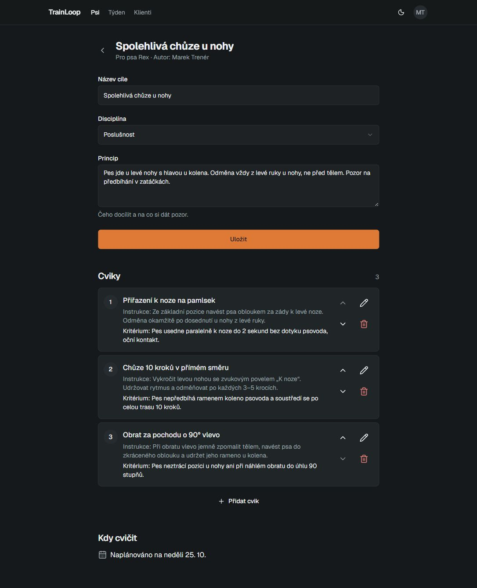
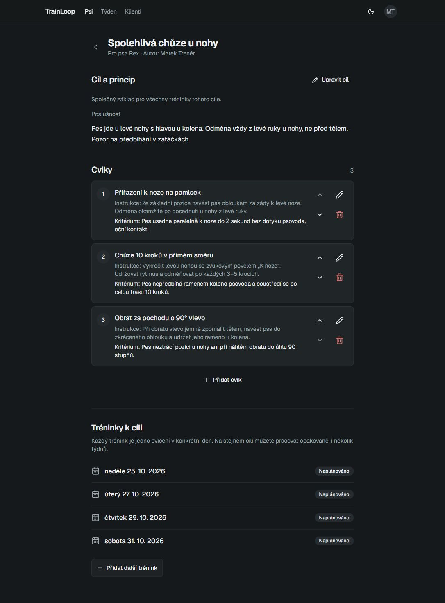
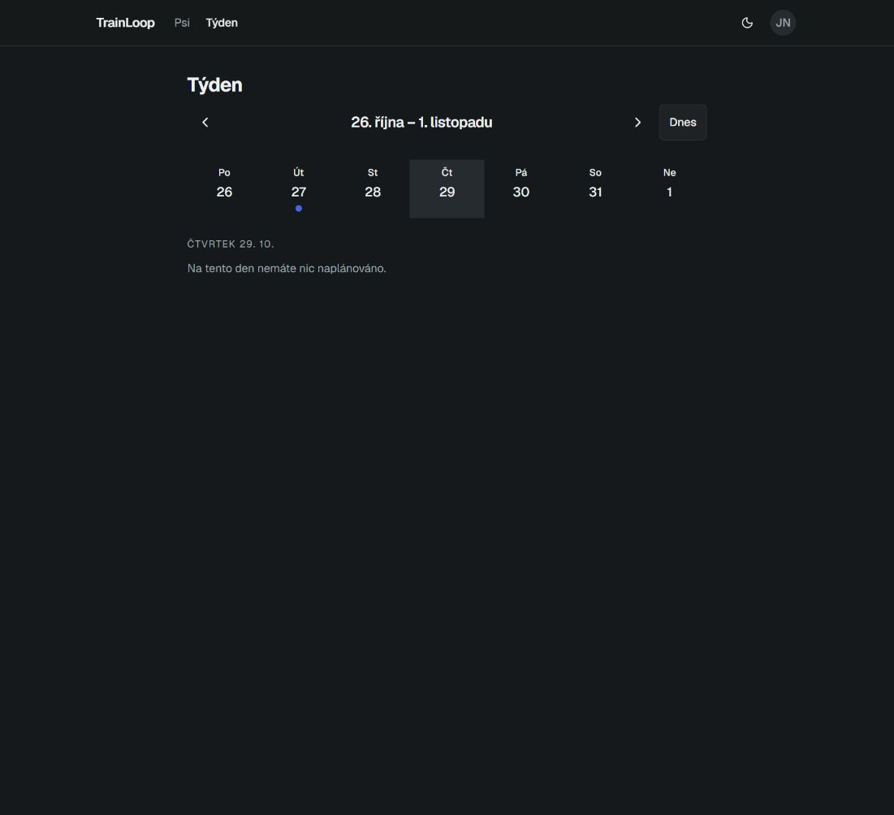
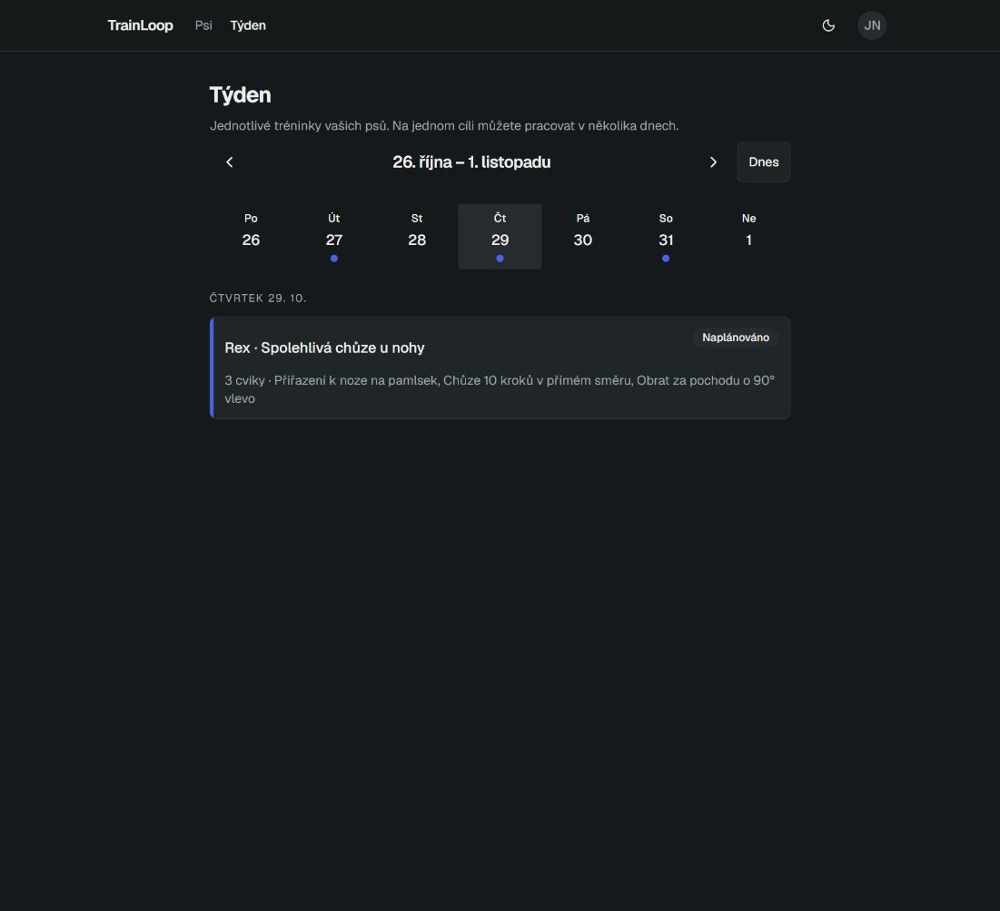
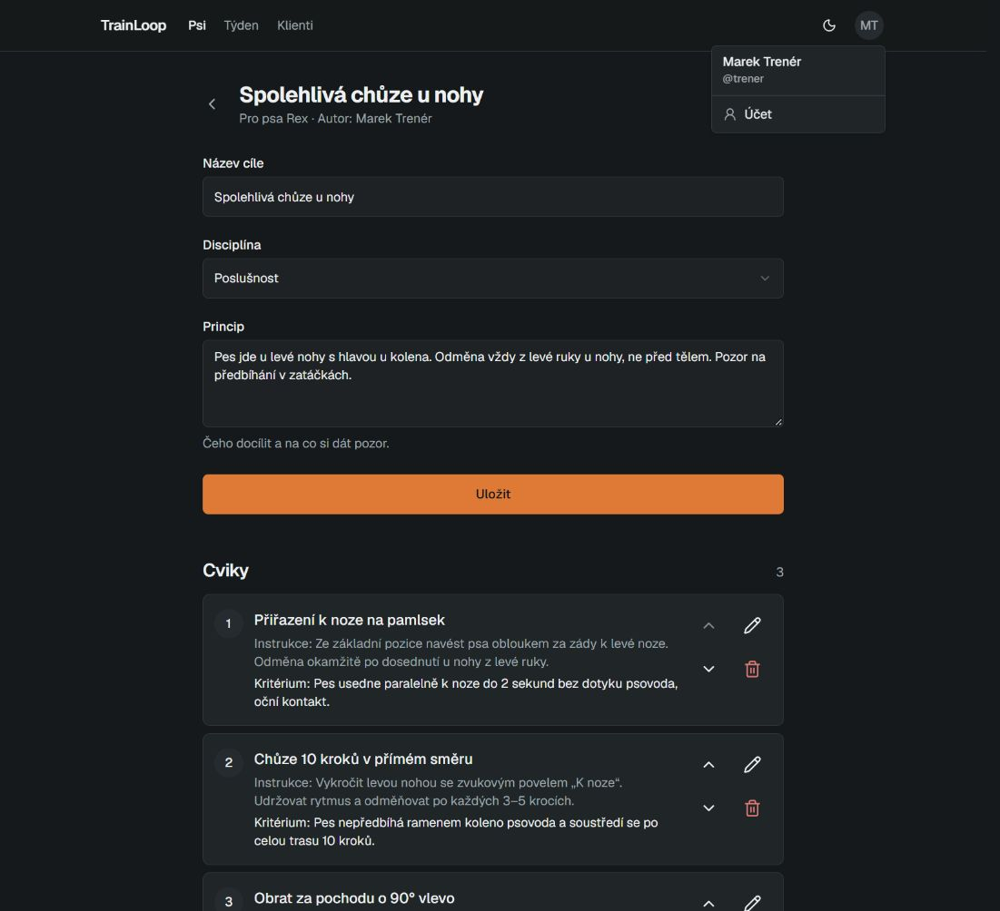
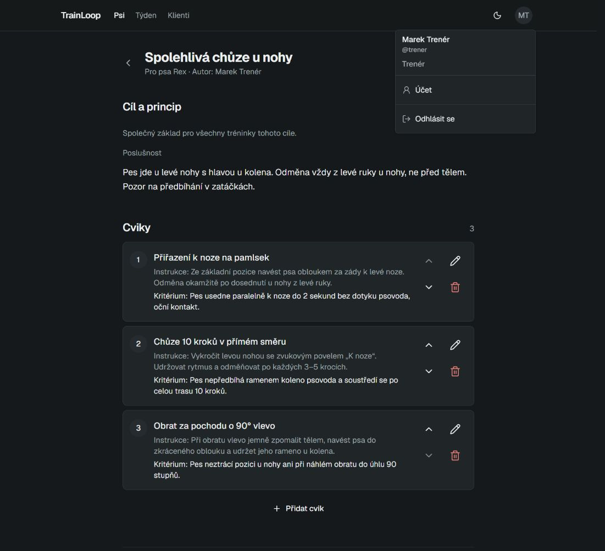
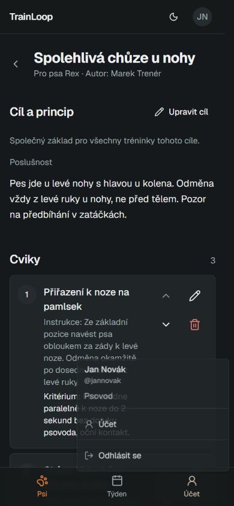
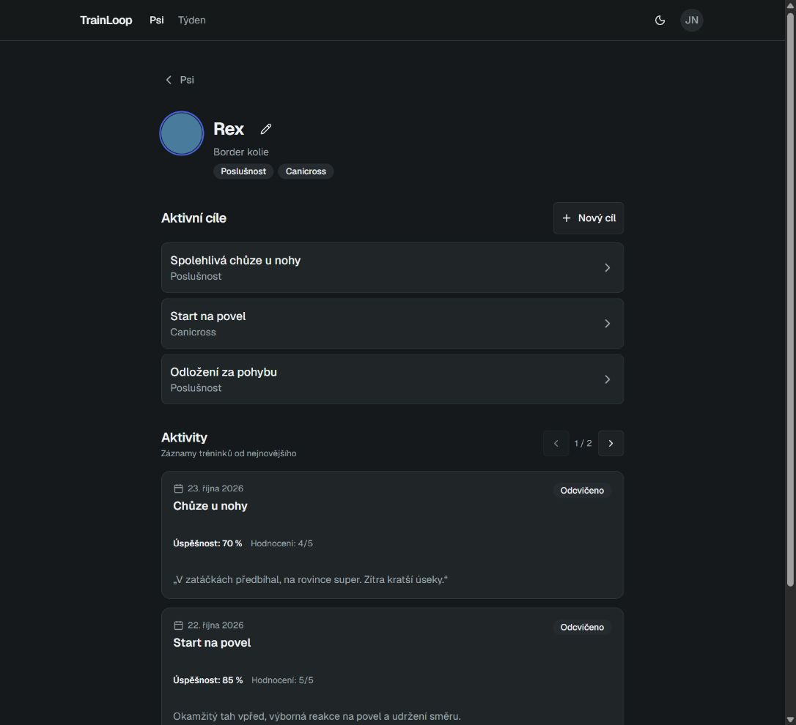
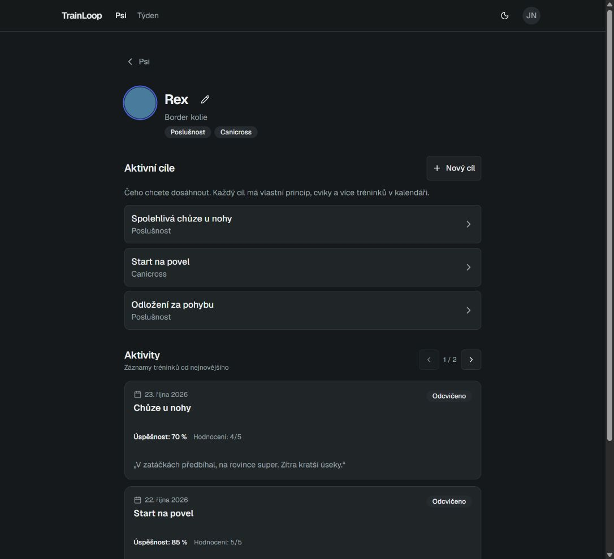

**TrainLoop feedback walkthrough — 25 October 2026**

I walked through both local builds as Marek (trainer), then Jan Novák (connected handler). The examples use Rex and the seeded goal “Spolehlivá chůze u nohy”.

[Open original main](http://localhost:3050/dogs/dog-rex-1/goals/goal-1) · [Open feedback build](http://127.0.0.1:3051/dogs/dog-rex-1/goals/goal-1)

The screenshots compare GitHub `main` at `e673238` with application commit `10551fb` on `codex/staging-feedback`. The branch also includes this guide and its screenshots for PR review. The walkthrough changed only seeded local demonstration data; it did not change application source. Start both builds with the linked startup guide before opening the local URLs above.

| Feedback                                                | Original main                                                       | Feedback build                                                                                                        |
| ------------------------------------------------------- | ------------------------------------------------------------------- | --------------------------------------------------------------------------------------------------------------------- |
| A goal should last weeks and contain multiple trainings | One planned session prevents adding another                         | The same goal retains its principle and exercises and has separately dated sessions                                   |
| Review the design                                       | Goal detail opens directly as an editing form                       | Readable “Cíl a princip” overview, explicit “Upravit cíl”, separate “Tréninky k cíli”                                 |
| Logout from the profile icon                            | Profile → Účet → Odhlásit se                                        | Profile → Odhlásit se; mobile bottom account icon opens the same menu                                                 |
| Dog photo does not save                                 | Image URL drops the API prefix; some valid phone files are rejected | API prefix preserved; generic/missing MIME metadata accepted when content validation passes; HEIF extension supported |
| Focus the demo on trainer and handler                   | Existing roles and registration                                     | Demo uses those two roles; independent-handler functionality was not expanded                                         |

**1. One goal, several training days**

Main has the existing Sunday 25 October session and no add-training action. In the feedback build I used “Přidat další trénink” to add Tuesday 27, Thursday 29 and Saturday 31 October 2026. After a refresh, all four sessions remained. The original principle and all three exercises stayed the same.

Each date is added separately. The calendar disables already-booked days; this is repeated scheduling, not an automatic weekly recurrence feature. Existing planned sessions are preserved.

| Main: editing form and one planned date    | Feedback: goal overview and multiple sessions                         |
| ------------------------------------------ | --------------------------------------------------------------------- |
|  |  |

**2. The handler sees those dates**

After switching to Jan Novák, I opened the week of 26 October–1 November. Thursday is empty in main; the feedback build shows Rex’s scheduled session. Tuesday, Thursday and Saturday are marked in the week strip. Clicking the new session title opens the same goal and its exercises.

The difference in calendar contents comes from the three sessions created during this walkthrough. Main could not create additional planned sessions for that already-scheduled goal.

| Main: Thursday has no session                              | Feedback: Thursday contains Rex’s session                          |
| ---------------------------------------------------------- | ------------------------------------------------------------------ |
|  |  |

**3. Direct logout and mobile access**

I opened both profile menus. Main offers only “Účet”; its logout button is on the account page. The feedback menu shows the role and “Odhlásit se”. I used that action successfully to return to the public landing page before signing in as the handler.

| Main profile menu                                          | Feedback profile menu                                              |
| ---------------------------------------------------------- | ------------------------------------------------------------------ |
|  |  |

At a 390 × 844 mobile viewport, the new header remains visible and the bottom account icon opens an upward menu with logout. The viewport override was reset after inspection.

**4. Dog-photo persistence**

I uploaded the same synthetic blue PNG to Rex in each isolated local database, saved, and refreshed. Both copies displayed the image after refresh. The blue circle is the test image, not a real dog photo, and is left in both local copies so the result remains inspectable.

The ordinary PNG problem did not reproduce on local main. The observed URL difference explains the routing correction: main loads from `http://localhost:4050/uploads/dogs/…`, while the feedback build loads from `http://127.0.0.1:4051/api/uploads/dogs/…`. Keeping `/api` matters when staging routes only that prefix to the backend. The staging environment itself was not retested in this walkthrough.

The earlier automated checks cover generic phone MIME metadata, byte validation, persistence, replacement/removal, ownership and persistence after a server restart. The browser walkthrough verified an ordinary PNG only; it did not upload a real HEIC/HEIF image.

| Main after saving and refreshing                                 | Feedback after saving and refreshing                                     |
| ---------------------------------------------------------------- | ------------------------------------------------------------------------ |
|  |  |

**5. Design and sprint scope**

The visible design work makes the goal/principle, exercises and dated trainings distinct, adds explicit editing, supports wrapping titles, and keeps profile access available on mobile. It follows the repository’s design rules and existing components. Exact matching against Figma remains unverified because that file could not be accessed.

One wording issue found during this walkthrough remains: the browser-tab title for the goal still reads “Tvorba tréninku”. It should be updated to the goal terminology.

The walkthrough uses only trainer and connected handler. Existing standalone-handler registration remains available; no new standalone-handler features were added. Moving/skipping sessions and the exercise-by-exercise execution flow are outside this change.

[Implementation and startup guide](../../FEEDBACK-BUILD.md) · [Previous automated verification: 382 tests passed](../../VERIFICATION.md)

To repeat the demo in fresh local copies, sign in as trainer `trener@trainloop.cz`, open Jan Novák → Rex → “Spolehlivá chůze u nohy”, and add three future dates. Then sign out and sign in as handler `jan.novak@seznam.cz` to view them in the week. Both seeded local accounts use `password1`. These screenshots are evidence from the local walkthrough; demo database contents and uploaded files are not included in Git.
